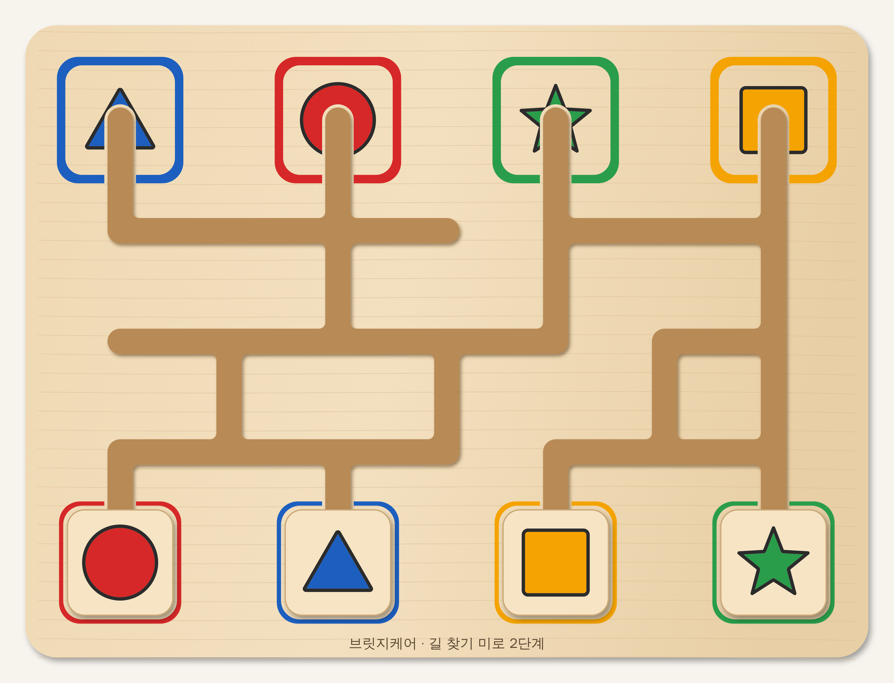

# 브릿지케어 인지교구 · 길 찾기 미로판 2단계(경증)

400 × 300 × 18 mm 자작나무 합판에 CNC로 홈을 파고 UV로 인쇄하는 교체형 교구판이에요.
블록 4개(동그라미, 세모, 네모, 별)를 홈을 따라 밀어서 같은 모양이 있는 칸까지 옮겨요.



## 놀이 방법

1. 아래 줄 **출발 칸**에 블록 4개를 놓아요. 블록 밑의 나무 기둥(목심)이 홈에 들어가요.
2. 블록을 홈을 따라 밀어서 위 줄에 **같은 모양이 그려진 칸**까지 옮겨요.
3. 블록이 제자리에 들어가면 색 테두리만 남아서 "딱 맞았다"는 게 보여요.
4. 막다른 길이 2곳 있어요. 길을 미리 보고 계획하는 연습이에요.
5. 블록 4개를 한 번에 하나씩 옮기면 모두 도착할 수 있어요.

정답 경로는 [정답지](output/answer_key.png)에 있어요. 선생님용으로 쓰세요.

**쓰는 능력:** 모양·색 맞추기, 길 계획하기(실행기능), 시지각, 눈과 손 협응, 소근육

## 파일 목록 (`output/` 폴더)

| 파일 | 용도 | 누구에게 |
|---|---|---|
| `maze_L2_board_CNC.dxf` | 판 CNC 가공 (외곽 + 홈) | CNC 업체 |
| `maze_L2_blocks_CNC.dxf` | 블록 4개 + 공차 테스트 조각 | CNC 업체 |
| `maze_L2_board_PRINT.svg` | 판 컬러 인쇄 (글자는 외곽선 처리됨) | UV 인쇄 업체 |
| `maze_L2_board_PRINT_white.svg` | 판 화이트 밑색 레이어 | UV 인쇄 업체 |
| `maze_L2_blocks_PRINT.svg` | 블록 윗면 인쇄 | UV 인쇄 업체 |
| `drawing_A3.pdf` | 치수가 들어간 제작 도면 (A3) | 모든 업체, 견적용 |
| `maze_L2_board_PRINT.pdf` | 인쇄 교정용 (분홍 선 = 위치 확인용) | 인쇄 확인 |
| `preview.png`, `answer_key.png/pdf` | 완성 미리보기, 정답지 | 상세페이지, 선생님용 |

모든 파일의 단위는 **mm**이고, 원점은 **판 왼쪽 아래 모서리**예요. CNC 파일과 인쇄 파일은 같은 좌표를 써요.

## 규격

| 항목 | 값 | 이유 |
|---|---|---|
| 판 | 400 × 300 × 18, 모서리 R15 | 교체형 판 규격, 택배 가능 |
| 홈 | 폭 12, 깊이 8, 끝 R6 | Ø10 목심 + 여유 2mm. 깊이 8이면 판이 10mm 남아 튼튼함 |
| 홈 사이 나무 모서리 | R3 | 손 다침 방지, 블록 걸림 방지 |
| 홈 간격 | 가로 51.67 / 세로 52.5 | 50mm 블록이 옆 칸 블록과 부딪히지 않는 최소 간격 |
| 블록 | 50 × 50 × 18, R8, 모서리 R3 라운딩 | 어르신 손에 잡기 쉽고 삼킬 위험 없음 |
| 목심 | Ø10 × 16 (블록에 10 박고 6 나옴) | 홈 바닥과 2mm 여유 → 블록이 판 위에 얹혀 미끄러짐 |
| 도착 테두리 | 60 바깥 / 52 안쪽 | 블록(50)이 들어가도 4mm 색 테두리가 보임 |
| 인쇄 여백 | 홈 가장자리에서 1.5mm 띄움 | 홈 안쪽으로 잉크가 번지지 않게 |

## CNC 가공 방법

**DXF 레이어 설명**

| 레이어 | 가공 |
|---|---|
| `01_PROFILE_THROUGH_18mm` | 외곽 따라 관통 컷 (바깥쪽 보정, 탭 남김) |
| `02_POCKET_DEPTH_8mm` | 닫힌 영역을 깊이 8.0으로 포켓 가공 (안쪽 섬 2개 포함) |
| `03_CENTERLINE_REF_NOCUT` | 홈 중심선 참고용. **가공하지 않음**. Ø12 일자 비트로 이 선을 한 번에 따라가도 됨 |
| `04_DRILL_D10_DEPTH10` | (블록) Ø10 구멍, 깊이 10 |
| `09_NOTES_NOCUT` | 메모. 가공하지 않음 |

**순서**
1. 홈 포켓 가공. Ø6 엔드밀을 권장해요. 홈 끝과 모서리는 R6 이상이라 Ø12 이하 날이면 다 깎여요.
2. 외곽 관통 컷. 홈을 먼저 파야 판이 움직이지 않아요.
3. 판 윗면 외곽을 R3 트리머로 라운딩해요.
4. 홈 안쪽을 #180으로 샌딩해요. 블록을 넣고 밀어봐서 걸리는 곳이 없어야 해요.

**블록**
- 같은 18T 판에서 잘라요.
- 드릴 구멍을 뚫은 면이 **밑면**이고, 인쇄는 반대쪽 면에 해요.
- 목심 끝을 1mm 모따기하면 홈에 더 잘 들어가요.

## 시제품 전에 꼭 할 것: 공차 테스트

`maze_L2_blocks_CNC.dxf`에 **테스트 조각**(150 × 70)이 들어 있어요. 홈 폭이 11.5, 12.0, 12.5mm로 3개 있어요.

시중 목심은 표기보다 조금 가늘거나 굵을 수 있어요. 실제로 쓸 목심을 끼운 블록으로 세 홈을 밀어보고, **가장 부드럽지만 덜컹거리지 않는 폭**을 고르세요.
12.0이 아니라면 `generate.py`의 `GROOVE_W` 값을 바꾸고 다시 실행하면 돼요.

## UV 인쇄

1. 판을 원점(왼쪽 아래) 기준으로 지그에 맞춰 놓아요.
2. `_white.svg`로 화이트 밑색을 먼저 찍고, 그 위에 `PRINT.svg` 컬러를 찍어요.
3. `GUIDE_DO_NOT_PRINT` 그룹(분홍 선)은 위치 확인용이에요. 인쇄 전에 숨겨야 해요.
4. 색: 빨강 `#D62828`, 파랑 `#1D5FBF`, 노랑 `#F4A300`, 초록 `#2A9D4B`, 외곽선 `#2B2B2B`
   - 노랑은 나무색 위에서도 잘 보이도록 주황빛으로 골랐고, 모든 모양에 진한 외곽선을 넣었어요.

## 마감

- 무광 수성 UV 코팅이나 수성 바니시를 2회 칠해요.
- 대여용이라 **알코올 소독제에 견디는지** 꼭 확인하세요.
- 반사가 적은 무광이 어르신 눈에 편해요.

## 원판에서 몇 장 나오나

1220 × 2440 원판에서 판 사이 10mm, 가장자리 10mm를 띄우면:
- 가로세로를 섞어 배치하면 **판 15~19장**
- 남는 조각으로 블록(50×50)을 만들 수 있어요. 판 1장에 블록 4개가 필요해요.

## 업체에 보낼 때 체크리스트

- [ ] `drawing_A3.pdf` + DXF 2개 + 인쇄 SVG 3개
- [ ] 재질: 자작나무 합판 18T (러시아·핀란드산 등 원산지 지정 여부)
- [ ] 수량: 시제품 1세트 먼저 (판 1 + 블록 4 + 테스트 조각 1)
- [ ] 가공: 홈 포켓 8mm, 외곽 컷, R3 라운딩, 샌딩
- [ ] 인쇄: 화이트 + 컬러, 판과 블록 윗면
- [ ] 마감: 무광 코팅 (소독제 견딤)
- [ ] 목심 Ø10 × 16 조립을 포함할지 확인

## 다시 만들기 / 바꾸기

```bash
pip install ezdxf shapely fonttools
python3 generate.py      # output/ 에 DXF, SVG 생성 (미로가 풀리는지 자동 확인)
node render.js           # PNG, PDF 생성 (Playwright + Chromium 필요)
```

- 미로 모양은 `generate.py`의 `H_EDGES`, `V_EDGES`에서 바꿔요.
- 출발·도착 모양 배치는 `STARTS`, `TARGETS`에서 바꿔요.
- 실행할 때마다 모든 블록이 도착할 수 있는지, 다른 블록 칸을 지나가지 않는지 자동으로 확인해요.

> 이 미로판은 브릿지케어용으로 새로 설계한 디자인이에요. "홈을 따라 블록을 옮기는" 놀이 방식은 일반적인 것이고, 길 배치·그림·판 모양은 다른 회사 제품을 복제하지 않았어요.
